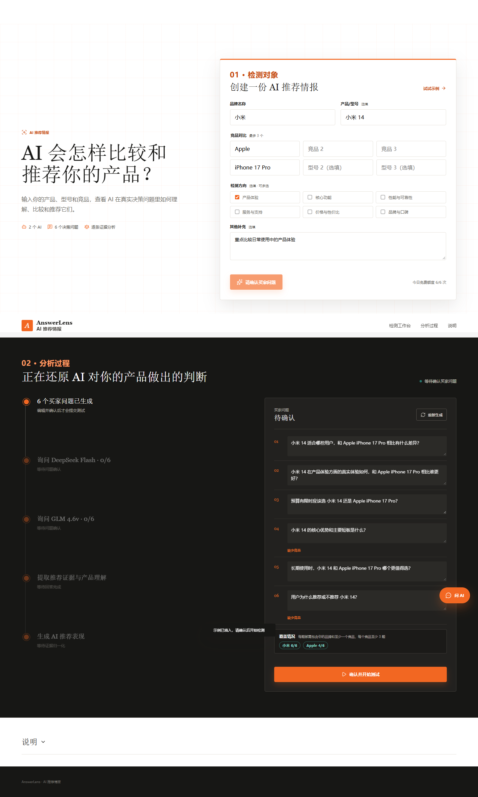
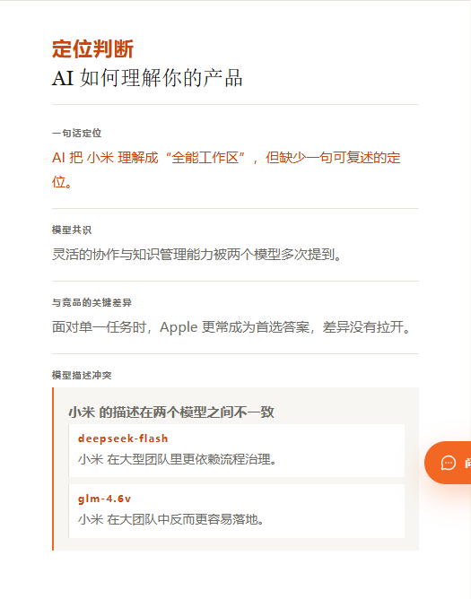
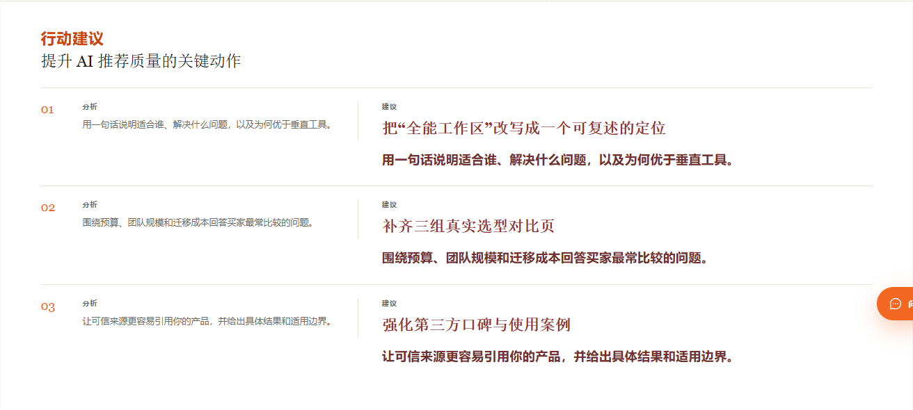
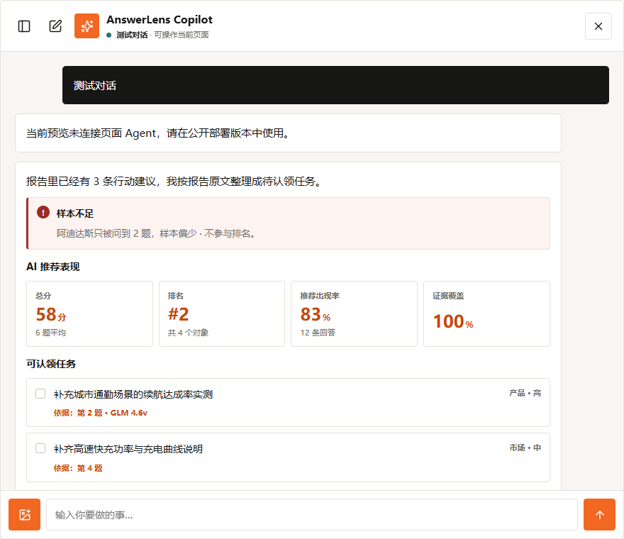

<div align="center">

# AnswerLens · AI 推荐情报

**买家先问 AI，再决定买什么。AnswerLens 让你看见 AI 到底怎么理解、比较和推荐你的产品。**

[在线体验](https://answerlens-dev.vercel.app) · [工作原理](#工作原理) · [评分口径](#评分口径) · [本地运行](#本地运行) · [自己部署一份](#自己部署一份)


</div>

---

## 这是什么

搜索引擎时代你看关键词排名；现在买家把"哪个更好用"直接问给 AI，AI 的回答就成了新的货架。

AnswerLens 把这件事变成一次**可复现的检测**：让两个真实大模型回答同一组买家会问的购买决策问题，再逐条判断 AI 有没有推荐你、把你排在第几位、给了你什么定位，最后给出 0–100 的 **AI 推荐表现**分，以及可以直接执行的改进动作。

- **6 个买家问题**由模型按你的品牌/型号/竞品/检测方向现场生成，可以自己改（每题必须包含你的品牌，至少出现一个竞品）
- **12 条真实回答**：2 个模型 × 6 个问题，全部保留在报告里，可以逐条查看
- **逐维判定**：每条回答都给出推荐出现、顺位、倾向、证据、竞品差异的得分和判定依据（引用原句）
- **完整报告**：AI 推荐表现、竞品对比与排名、定位判断、行动建议（带联网来源）
- **AnswerLens Copilot**：一个读得懂当前页面和报告的 AI 助手，能直接帮你填表、解释得分、联网查资料

所有数字都来自真实模型调用，没有预设模板；判不了的地方显示 `-`，不编造。

## 工作原理

```text
你的输入（品牌 / 型号 / 竞品 / 检测方向 / 其他补充）
        │
        ├─ ① 生成 6 个买家问题        DeepSeek Flash，可人工编辑后再提交
        │
        ├─ ② 12 条真实回答            DeepSeek Flash × 6  +  GLM 4.6v × 6
        │
        ├─ ③ 逐条判定                 judge 模型逐维度打分并给出理由与原句
        │
        └─ ④ 汇总成报告               分数 / 排名 / 定位判断 / 行动建议（附联网来源）
```

每一步都在前端实时可视化：你能看到 `1/6 → 2/6 → … → 6/6` 的真实进度，而不是一个转圈的加载图标。

## 评分口径

单题得分 = 各维度得分按权重加权求和；总分 = 被问到题目的加权平均。

| 维度 | 权重 | 判定方式 |
| --- | --- | --- |
| 推荐出现 | 25% | 逐项判定：是否提到名称、是否给出评价、是否列入推荐清单、是否被列为首选、是否被否定 |
| 推荐顺位 | 25% | 第 1 名 = 100，之后每降一名 −25；回答没有给出顺序时本项不参与 |
| 描述倾向 | 15% | 正面 100 / 中立 60 / 混合 40 / 负面 20 |
| 证据完整 | 20% | 具体主张 ÷（具体主张 + 笼统主张）× 100 |
| 竞品差异 | 15% | （显式比较 + 相对差异点 + 给出选择条件）÷ 3 × 100 |

- 某维度在某道题里无法判定时**不参与加权**，分母按剩余维度重算。
- 你的品牌每题都会被问到；每个竞品至少出现在 3 题。覆盖 2 题标记「样本偏少」（计分但不参与排名），少于 2 题标记「样本不足」（不显示分数、不参与排名，明细里显示 `-`）。
- judge 不可用时退化为规则判定，并在报告里明确标注「规则判定」。

完整口径在产品的「说明」模块里对用户公开，实现见 [api/_lib/judge.js](api/_lib/judge.js)。

## 界面

**检测工作台**：品牌、型号、最多 3 个竞品、检测方向、其他补充。型号和检测方向都是选填。



**定位判断**：一句话定位、两个模型的共识、与竞品的关键差异，以及模型之间的描述冲突。



**行动建议**：左侧是根据报告得出的分析，右侧是具体可执行的建议，每条最多带一个真实外部来源。



**AnswerLens Copilot**：可操作当前页面（填表、解释得分、检索报告数据、联网搜索），回答用结构化组件渲染。



## 技术栈

| 层 | 选型 | 说明 |
| --- | --- | --- |
| 前端 | 原生 HTML / CSS / JavaScript | 零构建、零框架；只 vendored 两个库，lucide（图标）和 anime.js（动效），都是 MIT |
| 后端 | Vercel Functions（Node，CommonJS） | 无数据库；共享逻辑在 [api/_lib](api/_lib) |
| 动效 | [`app-motion.js`](app-motion.js) + View Transitions API | 所有时长和缓动集中在一张场景表里，统一尊重 `prefers-reduced-motion` |
| 被测模型 | DeepSeek Flash、智谱 GLM 4.6v | 两个模型各答 6 题；GLM 同时负责图片识别 |
| Judge | DeepSeek Flash | temperature 0，逐条判定，输出结构化 JSON |
| 助手 | DeepSeek Flash | 只读工具 + 页面操作 + 联网搜索 |
| 搜索 | Serper | 给助手的联网查询和行动建议的来源链接 |
| 测试 | `node --test` + Playwright | 150 个单元测试 + 全流程视觉冒烟（桌面 / 移动） |

## 本地运行

```bash
git clone https://github.com/chenjunwen097-droid/answerlens.git
cd answerlens

npm test              # 150 个单元测试，不需要任何 API key
npm run test:visual   # 需要先执行 npx playwright install chromium
```

直接双击 `index.html` 也能打开界面并走完整流程——本地是 **mock 模式**，用内置示例数据驱动，不会调用任何模型。真实的模型调用只发生在部署环境（或配置了 `.env.local` 的 serverless 环境）里。

## 自己部署一份

1. 把仓库导入 [Vercel](https://vercel.com/new)
2. 按 [.env.example](.env.example) 填环境变量：DeepSeek、智谱 GLM、搜索服务各一个 key
3. `vercel deploy --prod`
4. 打开 `/api/health`，三个依赖都显示 ✓ 就说明配置正确（它会真实调用一次每个上游）

需要自己申请三个 key：DeepSeek、智谱、Serper。一次完整检测大致是 1 次问题生成 + 12 次回答 + 12 次判定，外加少量后台搜索，成本取决于你选择的模型和各家现价。

## 已知限制

这份清单是刻意保留的，部署前请务必读一遍：

- **额度和限流目前只在前端**：每天 6 次的限制存在浏览器 localStorage 里，`/api/analyze`、`/api/agent` 没有鉴权。公开部署前建议加服务端限流或鉴权，否则别人可以直接调用接口消耗你的模型额度。
- 对话、报告快照和额度都保存在浏览器本地，没有账号体系，清缓存或换设备就没了。
- 只调用两个模型，结果会随模型版本变化，适合看趋势，不适合当成一次性绝对结论。
- judge 与其中一个被测模型是同一个（DeepSeek Flash），存在自偏好风险；换成独立 judge 只需要改环境变量。
- 图片附件不进入对话历史。
- 自建 SearXNG 在数据中心 IP 上会被搜索引擎验证码拦截，所以默认改用 Serper（相关配置仍保留在 `api/_lib/research.js` 中作为回退）。

## Roadmap

- [ ] 账号体系与跨设备报告（Supabase + Postgres）
- [ ] 可分享的报告链接
- [ ] 服务端配额与限流
- [ ] 支持更多被测模型 / 用户自带模型
- [ ] judge 与被测模型解耦，并用人工标注样本校准

## 贡献

欢迎 PR。提交前请先读 [CONTRIBUTING.md](CONTRIBUTING.md)——本项目要求贡献者同意 CLA。

## 许可证

[MIT](LICENSE) © 2026 chenjunwen097-droid

---

## English

**AnswerLens** asks two real LLMs the same six buyer-decision questions about your product and your competitors, judges every answer dimension by dimension, and turns the result into a 0–100 "AI recommendation performance" score plus concrete actions.

- **6 generated buyer questions** (editable; every question must mention your brand)
- **12 real answers** — DeepSeek Flash × 6 and Zhipu GLM 4.6v × 6, all shown in the report
- **Per-answer verdicts** for recommendation presence, rank, tone, evidence quality and competitor differentiation, each with the quoted sentence it was judged from
- **Report**: score, competitor comparison and ranking, positioning diagnosis, action items with real sources
- **AnswerLens Copilot**: a page-aware assistant that fills the form, explains scores and searches the web

### Quick start

```bash
git clone https://github.com/chenjunwen097-droid/answerlens.git
cd answerlens

npm test              # 150 unit tests, no API keys required
npm run test:visual   # run `npx playwright install chromium` first
```

Open `index.html` directly to click through the product in mock mode. Real model calls happen inside the deployed serverless functions: copy `.env.example` to `.env.local`, add DeepSeek / Zhipu GLM / Serper keys, deploy to Vercel, then check `/api/health`.

### How it works

Questions → 12 real answers → per-answer judging (temperature 0, structured JSON) → report. Nothing is pre-generated: every number in the report traces back to a model answer, and anything that cannot be judged is shown as `-` instead of a made-up value.

### Motion

Every animation lives in [`app-motion.js`](app-motion.js): anime.js drives the staggered reveals, numbers are tweened on `requestAnimationFrame`, module switches use the View Transitions API, and `prefers-reduced-motion` turns all of it off from one place.

### Known limitations

Quota and rate limiting are client-side only — add server-side limits before exposing your deployment publicly. Conversations and reports live in `localStorage`. The judge is currently the same model as one of the tested models, which carries a self-preference risk.

MIT licensed. Contributions require a CLA — see [CONTRIBUTING.md](CONTRIBUTING.md).

---

<div align="center">
<sub>AnswerLens is not affiliated with DeepSeek, Zhipu AI or Serper.</sub>
</div>
